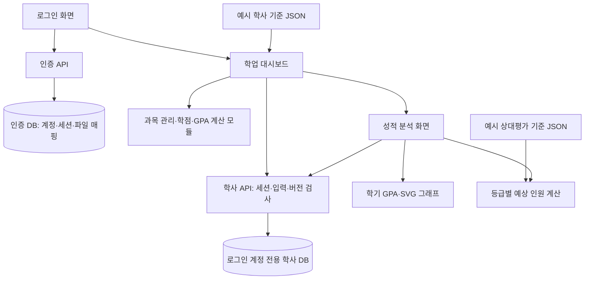

# ENDPoinT 핵심 코드 리뷰 및 질의응답 가이드

> 기준일: 2026-11-13 · 현재 작업 폴더의 소스 기준
>
> 필수 기능 구현을 마친 프로젝트를 설명하고 코드 리뷰·발표 질의응답을 준비하기 위한 문서다. 별도의 요구사항 명세서와 대조해 완료 여부를 판정한 문서는 아니다. 설계 이유는 현재 코드에서 확인되는 구조와 그 효과를 설명하며, 구현자의 과거 의사결정을 확인한 것은 아니다.

## 목차

1. [발표 시작용 설명](#1-발표-시작용-설명)
2. [전체 구조와 파일 지도](#2-전체-구조와-파일-지도)
3. [공통 데이터 모델과 검증](#3-공통-데이터-모델과-검증)
4. [회원가입·로그인·세션](#4-회원가입로그인세션)
5. [계정별 저장과 동시 수정 처리](#5-계정별-저장과-동시-수정-처리)
6. [과목 추가·수정·삭제와 화면 반영](#6-과목-추가수정삭제와-화면-반영)
7. [학점·수료·졸업 계산](#7-학점수료졸업-계산)
8. [GPA 계산과 실제 계산 예제](#8-gpa-계산과-실제-계산-예제)
9. [성적 그래프와 상대평가 시뮬레이션](#9-성적-그래프와-상대평가-시뮬레이션)
10. [API와 오류 처리](#10-api와-오류-처리)
11. [설계 선택과 장단점](#11-설계-선택과-장단점)
12. [검증 결과와 검증 범위](#12-검증-결과와-검증-범위)
13. [예상 질의응답](#13-예상-질의응답)
14. [발표·시연 순서와 코드 탐색 순서](#14-발표시연-순서와-코드-탐색-순서)

## 1. 발표 시작용 설명

### 약 1분 설명

“ENDPoinT는 사용자가 직접 입력한 과목과 성적을 바탕으로 학업 현황을 보여주는 웹 애플리케이션입니다. 회원가입과 로그인 후 과목을 추가·수정·삭제하면 취득 학점, 수강 중 학점, 누적 GPA, 수료·졸업 기준까지 남은 학점을 다시 계산합니다. 별도 성적 분석 화면에서는 학기별 GPA 변화와 상대평가 비율에 따른 등급별 예상 인원을 확인할 수 있습니다.

구조적으로는 화면 처리, 학점·성적 계산, 인증·저장을 분리했습니다. Node.js 내장 HTTP 서버와 SQLite를 사용하며, 계정·세션은 공용 인증 DB에, 과목·학년은 계정별 전용 DB 파일에 저장합니다. 데이터 저장은 서버가 검증한 세션의 사용자로만 처리하고, 저장 버전을 비교해 다른 탭의 변경을 덮어쓰지 않도록 했습니다.

학사 기준과 상대평가 기준은 예시입니다. 실제 학교 포털과 연동한 서비스는 아니며, 수강 중 과목을 포함하는 졸업 잔여 학점은 이수를 가정한 예상치입니다.”

### 설명에서 강조할 세 가지

- **지표마다 계산 대상을 구분한다.** F는 GPA에 포함하지만 취득 학점에서는 제외한다. 수강 중 과목은 GPA에서 제외하지만 졸업 예상 계산에는 포함한다.
- **사용자 데이터의 최종 판단은 서버가 한다.** 브라우저가 보낸 평점·사용자 지정값을 그대로 신뢰하지 않는다.
- **저장 성공 후 화면 상태를 확정한다.** 저장 실패나 버전 충돌을 성공처럼 표시하지 않는다.

## 2. 전체 구조와 파일 지도



화면과 API를 같은 서버·출처에서 제공한다. 클라이언트는 ES 모듈을 직접 불러오고, 서버도 같은 `grades.js`의 성적표·분류 상수를 가져와 검증에 사용한다.

| 계층 | 주요 파일 | 맡은 책임 |
| --- | --- | --- |
| 화면 구조 | [`public/index.html`](public/index.html), [`public/grade-analysis.html`](public/grade-analysis.html), [`public/login.html`](public/login.html) | 입력 폼, 요약 카드, 표, 분석 영역 |
| 학업 화면 제어 | [`public/dashboard.js`](public/dashboard.js) | 로그인 확인, 데이터 로딩, 과목 CRUD, 학년 변경, 요약 갱신 |
| 분석 화면 제어 | [`public/grade-analysis.js`](public/grade-analysis.js) | 개인 과목 로딩, 누적·선택 학기 GPA, 그래프 연결 |
| 클라이언트 통신 | [`public/js/auth/api.js`](public/js/auth/api.js), [`public/js/academic-api.js`](public/js/academic-api.js) | 인증·학사 API 요청과 오류 전달 |
| 과목 도메인 | [`js/grades/grades.js`](js/grades/grades.js) | 과목 생성·수정·삭제·검색, 등급 상수, 요약 함수 |
| GPA | [`js/grades/gpa.js`](js/grades/gpa.js) | 누적·선택 학기 가중 평균과 산정·등록 학점 |
| 학점 | [`js/credits/`](js/credits/) | 수강 중·취득·수료·졸업 잔여 학점 계산 |
| 시각화 | [`js/graph/`](js/graph/) | 학기별 집계, SVG 그래프, 상대평가 인원 배분 |
| HTTP·인증 | [`server/app.js`](server/app.js), [`server/password.js`](server/password.js) | 라우팅, 세션, 비밀번호 검증, 출처·요청 제한 |
| 저장·검증 | [`server/db.js`](server/db.js), [`server/schema.sql`](server/schema.sql), [`server/academic.js`](server/academic.js) | SQLite 초기화, 개인 DB 선택, 입력 정규화, 버전 검사 |
| 예시 정책 | [`data/academic_requirements.json`](data/academic_requirements.json), [`data/grading_policy.json`](data/grading_policy.json) | 수료·졸업 기준과 상대평가 비율 |

**현재 저장 방식:** `localStorage`를 학사 데이터 저장소로 사용하지 않는다. 신규 계정의 첫 학사 조회 결과는 빈 과목 목록·1학년·버전 0이다. `data/courses.json`과 `data/user_info.json`은 공개 예시이며 개인 초기 데이터로 자동 주입하지 않는다. 일부 과거 개발 기록과 `js/graph/README.md`의 연동 전 설명은 현재 구현과 다르므로, 현행 소스를 우선한다.

## 3. 공통 데이터 모델과 검증

### 3.1 과목 객체

```js
{
  id: "course-1",
  courseName: "자료구조",
  credits: 3,
  grade: "A+",
  gradePoint: 4.5,
  semester: "2026-1",
  status: "completed",
  category: "major",
  isRetake: false
}
```

| 필드 | 의미·실제 저장 규칙 |
| --- | --- |
| `id` | 과목 식별자. 수정·삭제 기준이며 목록 내 중복 불가. 서버는 영문·숫자·`_`·`-`의 1~80자를 허용 |
| `courseName` | 과목명. 앞뒤 공백 제거 후 1~100자 |
| `credits` | 숫자형 학점. 0.5~30, 0.5 단위 |
| `grade` | 이수 완료는 A+~F의 지원 등급, 수강 중은 빈 문자열로 정규화 |
| `gradePoint` | 완료 과목은 등급표로 서버가 재계산, 수강 중은 `null` |
| `semester` | `YYYY-1` 또는 `YYYY-2` |
| `status` | `completed` 또는 `in_progress` |
| `category` | `major`·`minor`·`general`: 전공·부전공·교양 |
| `isRetake` | 재수강 여부를 저장하는 불리언. 현재 계산에서 기존 성적 대체를 수행하지 않음 |

학사 API는 다음 단위로 전체 상태를 주고받는다.

```js
{
  courses: [],
  profile: { grade: 1 }, // 현재 학년
  revision: 0          // 저장 버전
}
```

`profile.grade`는 학년이고 `course.grade`는 성적 등급이다. 같은 이름을 다른 문맥에서 쓰므로 설명할 때 구분한다. 과목은 최대 500개다.

### 3.2 검증을 세 단계로 나눈 이유

1. **HTML 폼:** `required`, `min`, `max`, `step`, `pattern`으로 입력 직후 피드백을 준다.
2. **`createCourse()`:** 문자열 학점을 숫자로 바꾸고 성적을 대문자로 정리하는 등 화면 입력을 과목 객체로 만든다.
3. **`validateAcademicState()`:** 직접 API를 호출해도 적용되는 최종 검증이다. 자료형, 학점 범위, 학기 형식, 중복 ID, 등급, 분류, 상태, 허용 필드를 검사한다.

클라이언트 검증은 편의 기능이고 서버 검증은 저장 경계다. 두 검증의 엄격함은 같지 않다. 예를 들어 `createCourse()`는 양수 학점과 비어 있지 않은 학기를 확인하지만, 서버는 0.5 단위와 학기 형식까지 제한한다. 서버는 정의하지 않은 `userId`·DB 경로 같은 필드도 거부한다.

등급표는 A+ 4.5, A0 4.0, B+ 3.5, B0 3.0, C+ 2.5, C0 2.0, D+ 1.5, D0 1.0, F 0이다. `gradePoint`를 임의로 바꿔 보내도 서버는 이 표로 다시 계산한다.

## 4. 회원가입·로그인·세션

**코드:** `server/app.js`의 `credentials()`, `startSession()`, `currentUser()`, `revoke()`와 `server/password.js`.

### 4.1 회원가입과 로그인 흐름

```text
회원가입: 입력 검증 → scrypt 해시 → users 저장 → 새 세션 발급 → 대시보드
로그인: IP·계정 요청 제한 → 사용자 조회 → 해시 검증 → 새 세션 발급
인증 요청: 쿠키 토큰 → SHA-256 → 세션·사용자 JOIN → 만료 확인 → 사용자 확정
로그아웃: 해당 세션 행 삭제 → 쿠키 만료
```

- 이메일은 앞뒤 공백을 제거하고 소문자로 저장한다. DB의 `UNIQUE` 제약으로 중복 가입을 막는다.
- 이름은 공백 제거 후 1~50자, 비밀번호는 15~128자다.
- `scrypt`에 16바이트 난수 salt를 사용한다. 설정은 `N=16384`, `r=8`, `p=5`, 파생 키 길이는 64바이트다.
- 저장 형식은 `scrypt$16384$8$5$<salt>$<hash>`다. 검증은 저장 형식 확인 후 같은 연산을 수행하고 `timingSafeEqual()`로 비교한다.
- 존재하지 않는 계정에도 미리 만든 더미 해시를 검증해 계정 존재에 따른 처리 시간 차이를 줄인다. 모든 시간 차이를 없앤다는 의미는 아니다.

### 4.2 세션 설계

세션 토큰은 `randomBytes(32)`를 64자리 16진 문자열로 바꿔 생성한다. 브라우저 쿠키에는 토큰을, DB에는 토큰의 SHA-256 해시와 사용자 ID·만료 시각을 저장한다. 비밀번호에는 비용이 큰 `scrypt`를 쓰고, 충분한 난수로 만든 세션 토큰에는 조회용 SHA-256을 사용하는 구조다.

| 항목 | 현재 동작과 이유 |
| --- | --- |
| 유효기간 | 발급 시점부터 최대 24시간. 일반 조회로 만료를 연장하지 않음 |
| 재로그인 | 요청에 실린 기존 세션을 폐기하고 새 토큰 발급. 해당 계정의 모든 기기 세션을 일괄 폐기하지는 않음 |
| 서버 재시작 | 세션이 SQLite에 남으므로 만료 전이면 유지 |
| 쿠키 | `HttpOnly`, `SameSite=Lax`, `Path=/`. 운영 모드는 `Secure`와 `__Host-` 접두사 적용 |
| 중복 쿠키 | 동일 이름의 세션 쿠키가 여러 개면 어느 값도 인증에 사용하지 않음 |
| 상태 변경 요청 | 설정된 `APP_ORIGIN`과 `Origin`이 일치해야 통과 |

### 4.3 요청 제한과 공개 파일 제어

회원가입·로그인은 기본 IP당 15분에 합산 30회, 로그인은 이메일당 15분에 10회로 제한한다. 비밀번호 오류만 세는 방식이 아니라 허용된 경로의 시도를 집계한다. 이메일별 카운터는 로그인 성공 시 초기화한다. 만료 시각은 최초 기록 시 정해지는 고정 구간이며 매 요청마다 15분씩 연장하지 않는다.

제한 기록은 `auth_attempts`에 저장해 서버 재시작 후에도 유지한다. 비밀번호 해시 작업은 동시에 최대 2개로 제한하고, 초과하면 503을 반환한다. 전달 IP 헤더 대신 소켓의 접속 주소를 사용한다.

정적 파일은 `staticFiles`에 등록된 경로만 제공한다. `/server/app.js`, DB, `.env` 등은 공개하지 않는다. HTML 자체는 공개 파일이지만 개인정보 조회·저장은 인증된 API에서만 가능하다. 화면의 로그인 리다이렉트와 데이터 접근 통제를 구분해야 한다.

## 5. 계정별 저장과 동시 수정 처리

**코드:** `server/schema.sql`, `server/academic.js`의 `createAcademicStore()`, `withDatabase()`, `write()`.

### 5.1 두 종류의 DB

```text
storage/
├─ team07.db
│  ├─ users          : 계정·비밀번호 해시
│  ├─ sessions       : 세션 해시·사용자·만료
│  ├─ auth_attempts  : 요청 제한 기록
│  └─ user_databases : 사용자 ID → 서버가 생성한 storage_key
└─ users/
   ├─ <사용자 A의 64자리 난수>.db
   └─ <사용자 B의 64자리 난수>.db
      └─ academic_state: 과목 JSON·학년·버전·DB 식별 키
```

인증 DB 경로를 바꾸면 같은 폴더의 `users/`에 개인 DB를 만든다. `:memory:` 설정에서는 개인 DB도 키별 메모리 DB로 분리한다.

개인 DB는 첫 학사 데이터 접근 때 생성한다. 계정 ID와 별개인 난수 파일명을 사용하므로 계정 삭제 후 숫자 ID가 재사용되어도 과거 파일에 자동 연결되지 않는다. 파일 내부 `storage_key`도 매핑과 비교한다. 디스크 DB는 요청마다 닫아 파일 핸들이 사용자 수만큼 누적되지 않게 한다.

`X-Account-Id`는 DB 선택자가 아니다. **세션으로 사용자 결정 → 헤더와 일치 확인 → 세션 사용자로 DB 선택** 순서다. 헤더는 다른 탭에서 계정이 바뀌었을 때 이전 화면이 새 계정에 데이터를 저장하는 일을 감지한다. 다른 사용자 ID나 DB 경로를 쿼리·본문으로 지정하는 기능은 없다.

PUT 요청은 본문 수신 전과 후에 세션을 확인한다. 본문을 천천히 업로드하는 동안 로그아웃되거나 세션이 만료돼도 저장하지 않기 위해서다.

### 5.2 한 행에 전체 상태를 저장하는 이유

개인 DB의 `academic_state`는 `singleton = 1`인 한 행이다. 과목 배열은 JSON 문자열로, 학년과 버전은 별도 열로 보관한다. 화면이 과목 전체를 읽고 계산하는 현재 사용 방식에 맞고, 목록·학년을 한 번의 UPDATE로 바꿀 수 있다.

대신 과목 하나만 수정해도 전체 배열을 보내고 다시 직렬화한다. SQL로 과목별 검색·통계·참조 관계를 관리하기도 어렵다. 과목별 행 저장이나 부분 수정 API로 전환할 필요가 생기는 지점이다. 인증 DB에는 WAL과 5초 `busy_timeout`을 설정하며, 개인 DB에는 5초 `busy_timeout`을 설정한다. 모든 DB가 WAL인 것은 아니다.

### 5.3 버전 비교로 덮어쓰기 방지

다음은 실제 UPDATE의 핵심이다.

```sql
UPDATE academic_state
SET courses = ?, current_year = ?, revision = revision + 1
WHERE singleton = 1 AND revision = ?;
```

탭 A와 B가 둘 다 버전 3을 읽었다고 가정한다.

1. A가 버전 3으로 저장하면 DB는 버전 4가 된다.
2. B가 버전 3으로 저장하면 조건에 맞는 행이 없어 `changes = 0`이다.
3. 서버는 409를 반환한다. B는 새로고침 후 최신 데이터로 다시 작업해야 한다.

이를 낙관적 동시성 제어라고 한다. 버전 비교와 갱신이 하나의 SQL 문장에 들어 있어, 별도로 확인하고 나중에 저장하는 사이의 경쟁을 피한다. 자동 병합이나 실시간 동기화를 구현한 것은 아니다. 학년 변경도 전체 상태의 버전을 증가시키므로 과목 수정과 충돌할 수 있다.

## 6. 과목 추가·수정·삭제와 화면 반영

**코드:** `js/grades/grades.js`, `public/dashboard.js`의 `submitCourse()`, `commitState()`, `refreshDashboard()`.

### 6.1 원본 배열을 직접 바꾸지 않는 과목 연산

| 함수 | 동작 | 선택 이유·주의점 |
| --- | --- | --- |
| `createCourse(input)` | 입력 정규화, 검증, ID 발급, 평점 구성 | 과목 생성 규칙을 한곳에 모음. 보통 `crypto.randomUUID()` 사용, 미지원 시 시각 문자열 대체 |
| `addCourse(courses, input)` | 새 과목을 추가한 새 배열 반환 | 저장 전 기존 상태 유지 |
| `updateCourse(courses, id, input)` | ID 유지, 입력 재검증, 해당 과목을 교체한 새 배열 반환 | 성적만 바뀌면 이전 평점을 재사용하지 않도록 재계산 |
| `removeCourse(courses, id)` | 해당 ID를 제외한 새 배열 반환 | 원본을 보존하며 삭제 후보 생성 |
| `getCourses(courses, filters)` | 분류·학기·과목명·상태 조건으로 필터링 | 화면의 조회 조건과 저장 데이터를 분리 |

불변 처리란 이 함수들이 원본 배열과 기존 과목을 직접 수정하지 않는다는 뜻이다. 모든 중첩 객체를 깊게 복사하는 구조는 아니다. 바꾸지 않은 과목 객체는 재사용한다. ID 중복은 서버가 최종 검사한다.

`updateCourse()`는 기존 객체와 변경 입력을 합친 뒤 `createCourse()`로 검증하고 마지막에 기존 ID를 복원한다. 완료 과목을 수강 중으로 바꾸면 성적은 `""`, 평점은 `null`이 된다. 반대로 완료로 바꾸려면 성적이 필요하다.

### 6.2 저장 성공 후 상태 확정

```text
폼 입력 → addCourse/updateCourse/removeCourse → nextCourses 생성
       → commitState(nextCourses, profile)
       → PUT /api/academic (현재 revision 포함)
       → 서버 검증·저장 성공
       → 응답의 courses/profile/revision을 화면 상태로 채택
       → 전체 요약과 목록 다시 계산
```

`commitState()`는 `saving`으로 중복 저장을 막고 관련 버튼을 비활성화한다. 성공 응답 전에는 기존 `courses`, `userInfo`, `revision`을 교체하지 않는다. 실패하면 오류를 폼·대화상자에 표시하고 기존 데이터와 입력을 유지한다. 학년 저장 실패 시 선택값도 원래 학년으로 되돌린다.

서버 응답을 상태로 사용하는 이유는 서버가 과목명 공백, 성적, 평점을 정규화하기 때문이다. 클라이언트가 예상한 값보다 실제 저장된 값이 기준이 된다.

### 6.3 목록 필터와 요약 계산의 분리

`refreshDashboard()`는 **전체 `courses`**로 학점·GPA를 계산한다. `renderFilteredCourses()`만 선택 학기로 목록을 좁힌다. 따라서 목록을 2026-1로 바꿔도 누적 GPA나 졸업 잔여 학점이 변하지 않는다.

과목 행의 수정·삭제는 목록 부모에 이벤트를 한 번 연결하고 `data-course-id`로 대상을 찾는 이벤트 위임 방식이다. 목록을 다시 그려도 버튼마다 이벤트를 재등록할 필요가 없다. 과목명과 메시지는 `textContent`로 표시한다. 삭제에는 `<dialog>` 확인 창을 사용하고, 폼을 닫을 때 초점을 복원한다.

## 7. 학점·수료·졸업 계산

### 7.1 지표별 계산 대상

| 과목 상태 | 취득 학점 | 수강 중 학점 | 수료 기준 차감 | 졸업 예상 차감 | GPA 분모·분자 |
| --- | --- | --- | --- | --- | --- |
| 완료, F 아님 | 포함 | 제외 | 포함 | 포함 | 학점 / 학점 × 평점 |
| 완료, F | 제외 | 제외 | 제외 | 제외 | 학점 / 0 |
| 수강 중 | 제외 | 포함 | 제외 | 포함 | 모두 제외 |

이 차이가 핵심 업무 규칙이다. 졸업 잔여 학점은 수강 중 과목 이수를 가정한 예상치이고, 수료 잔여 학점은 실제 취득 학점을 사용한다.

### 7.2 현재 수강 학점: `calculateCurrentCredits()`

`status === "in_progress"`인 과목을 `filter()`로 선택하고 `reduce()`로 학점을 더한다. 합계의 초기값을 0으로 두므로 빈 목록도 0이다.

**주의:** 현재 날짜·현재 학기를 판정하는 함수가 아니다. 과거 학기라도 상태가 수강 중이면 합산한다.

### 7.3 취득 학점: `calculateEarnedCredits()`

`completed && grade !== "F"`인 과목의 학점을 합산한다. F는 성적이 확정되었더라도 학점을 취득한 것으로 세지 않는 정책이다.

### 7.4 학년 수료 잔여: `calculateCompletionCredits()`

```text
목표 학년 → firstYear / secondYear / thirdYear / fourthYear
수료 잔여 = max(해당 학년 누적 기준 - 취득 학점, 0)
예: 2학년 기준 65, 취득 45 → 잔여 20
```

기준은 1학년 33, 2학년 65, 3학년 98, 4학년 130학점이다. 각 학년에서 추가로 들어야 할 학점이 아니라 해당 학년까지의 누적 기준이다. `Math.max(..., 0)`은 초과 이수 시 음수 잔여가 표시되는 것을 막는다.

### 7.5 졸업 예상 잔여: `calculateGraduationCredits()`

인정 대상은 `in_progress` 또는 `completed && grade !== "F"`다.

```text
전체 잔여 = max(130 - 인정 대상 전체 학점, 0)
전공 잔여 = max(70 - 인정 대상 중 category === "major"의 학점, 0)
```

전공 학점은 전체 학점에도 포함된다. 부전공·교양은 전체 합계에 포함되지만 전공 합계에는 포함되지 않는다. 반환값은 `totalRemainingCredits`, `majorRemainingCredits`다.

JSON에 부전공·복수전공·교양 기준도 있지만 이 함수는 전체·전공 두 항목만 계산한다. 잔여가 모두 0이어도 필수 과목, 졸업 시험, 어학 기준 등을 검사하지 않으므로 실제 졸업 가능 판정으로 설명하면 안 된다.

## 8. GPA 계산과 실제 계산 예제

### 8.1 학점 가중 평균

**코드:** `js/grades/gpa.js`의 내부 `calculateGPA()`와 공개 함수 `calculateSemesterGPA()`, `calculateCumulativeGPA()`.

```text
GPA = Σ(완료 과목의 학점 × 평점) / Σ(완료 과목의 학점)
```

과목별 학점이 다르므로 단순 평점 평균을 사용하지 않는다. 수강 중 과목은 평점이 없으므로 분모에서도 제외한다. F는 평점 0이지만 완료 과목이므로 분모에 포함한다.

처리 순서는 학기 선택 → 완료·수강 중 대상 확인 → 등록 학점 합산 → 완료 과목 추출 → 평점 검증 → 가중합과 산정 학점 계산 → 소수 둘째 자리 반올림이다. 매 과목이나 매 학기의 평균을 먼저 반올림해 누적하는 방식이 아니다.

| 반환값 | 의미 |
| --- | --- |
| `gpa` | 완료 과목의 가중 평균. 산정 대상이 없으면 `null` |
| `gpaCredits` | 완료 과목 학점 합계. F 포함 |
| `registeredCredits` | 완료 + 수강 중 과목 학점 합계 |

`null`과 0을 구분하는 이유는 “성적 없음”과 “실제 평균 0점”이 다르기 때문이다. 화면에서는 `null`을 `--`로 표시한다.

### 8.2 네 과목으로 설명하는 통합 예제

다음은 설명용 데이터이며 신규 계정에 자동으로 들어가는 과목이 아니다. 현재 학년은 2학년으로 가정한다.

| 과목 | 학기 | 구분 | 학점 | 상태 | 등급 / 평점 |
| --- | --- | --- | --- | --- | --- |
| 자료구조 | 2026-1 | 전공 | 3 | 완료 | A+ / 4.5 |
| 영어 | 2026-1 | 교양 | 2 | 완료 | B0 / 3.0 |
| 운영체제 | 2026-2 | 전공 | 3 | 완료 | F / 0 |
| 데이터베이스 | 2026-2 | 전공 | 3 | 수강 중 | 없음 / `null` |

```text
등록 학점       = 3 + 2 + 3 + 3 = 11
GPA 산정 학점   = 3 + 2 + 3     = 8
평점 가중합     = 3×4.5 + 2×3 + 3×0 = 19.5
누적 GPA        = 19.5 / 8 = 2.4375 → 2.44
취득 학점       = 3 + 2 = 5
수강 중 학점    = 3
2학년 수료 잔여 = 65 - 5 = 60
전체 졸업 잔여  = 130 - (3 + 2 + 3) = 122
전공 졸업 잔여  = 70 - (3 + 3) = 64
```

2026-1 GPA는 `19.5 / 5 = 3.90`, 2026-2 GPA는 `0 / 3 = 0.00`이다. 학기 GPA의 단순 평균 `(3.90 + 0.00) / 2 = 1.95`는 누적 GPA가 아니다. 학기별 산정 학점이 다르기 때문이다.

### 8.3 비슷한 함수들의 차이

| 함수 | 현재 용도 | 차이 |
| --- | --- | --- |
| `calculateCumulativeGPA()` | 두 화면의 누적 GPA | `gradePoint`를 검증하고 빈 대상은 `null` |
| `calculateSemesterGPA()` | 분석 화면의 선택 학기 카드 | 지정한 학기만 대상으로 같은 계산 |
| `calculateSemesterGpa()` | 그래프용 학기별 배열 | `Map`으로 집계, 분류 필터 제공, 잘못된 항목은 건너뜀, 평점 누락 시 등급표 사용 |
| `summarize()` | 과목 모듈의 요약 API·테스트 | 빈 목록 GPA가 0이며 현재 화면의 GPA 계산 경로에는 사용하지 않음 |

이름의 `GPA`와 `Gpa` 차이를 유의한다. 실제 API 저장 데이터는 서버가 평점을 정규화하므로 공통 정책으로 계산되지만, 임의 입력을 각 함수에 직접 넣으면 오류 처리·반올림 경계에서 차이가 생길 수 있다. 향후 공통 계산 규칙을 정리할 개선 지점이다.

## 9. 성적 그래프와 상대평가 시뮬레이션

### 9.1 학기별 GPA 집계와 SVG

**코드:** `js/graph/gradeGraph.js`의 `calculateSemesterGpa()`, `renderSemesterGraph()`.

1. 이수 완료 과목만 선택하고 전체·전공·교양 조건을 적용한다.
2. 유효한 학기·학점·평점을 가진 과목을 `Map`에 학기별로 모은다.
3. 학기마다 `학점×평점의 합`과 `학점 합`을 누적한다.
4. 학기를 오름차순 정렬하고 GPA를 계산한다.
5. 0~4.5를 세로 좌표로 변환해 SVG 선·점·텍스트로 그린다.

```text
y = 아래쪽 기준 좌표 - (GPA / 4.5) × 그래프 높이
```

SVG 좌표는 아래로 갈수록 커지므로 높은 GPA일수록 y를 작게 만든다. 학기가 하나면 중앙에 점을 그리고 선은 생략한다. 대상이 없으면 안내 문구를 표시한다. 학기가 많으면 최소 너비와 가로 스크롤을 사용한다.

외부 차트 라이브러리 없이 SVG를 사용해 설치 의존성을 늘리지 않고 벡터 형태로 표시한다. 대신 축·반응형 동작·접근성 등을 직접 구현해야 한다. 그래프에 `role="img"`, `aria-label`을 사용하고 예상 인원은 표도 제공한다. 이것만으로 접근성을 전부 검증했다고 볼 수는 없다.

그래프의 전체 구분에는 부전공도 포함된다. 별도 선택지는 전공·교양만 있다. 특정 구분에서 완료 과목이 없는 학기는 그 구분의 그래프에 나타나지 않는다. 분석 화면의 학기 선택 카드와 그래프 구분 선택은 서로 독립적이다.

### 9.2 최대 나머지 방식의 상대평가 인원 배분

**코드:** `js/graph/gradeRanges.js`의 `calculateGradeRanges()`.

입력은 수강자 수와 **등급별 개별 비율**이다. 예를 들어 A+ 15%, A0 15%이면 A 계열 합계가 30%라는 뜻이다. 석차 누적 상한을 입력하는 기능은 아니다.

```text
각 등급의 정확한 인원 = 전체 인원 × 등급 비율 / 100
1. 각 값을 내림해 기본 인원을 정한다.
2. 전체 인원에서 기본 인원 합을 빼 남은 인원을 구한다.
3. 소수 부분이 큰 등급부터 1명씩 추가한다.
4. 소수 부분이 같으면 A+, A0, B+, ... 순서로 우선한다.
```

예를 들어 3명을 A+ 50%, A0 50%, 나머지 등급 0%로 나누면 정확한 값은 1.5명씩이다. 둘 다 반올림하면 합계가 4명이 된다. 현재 방식은 먼저 1명씩 배정하고 남은 1명을 동률 우선순위에 따라 A+에 줘 **A+ 2명, A0 1명, 총 3명**을 유지한다.

기본 예시인 40명·비율 `[15, 15, 20, 20, 15, 10, 3, 2]`에서는 A+부터 D0까지 `[6, 6, 8, 8, 6, 4, 1, 1]`명이다. D+의 1.2명·D0의 0.8명 중 남은 1명을 D0에 배분한다.

| 입력 상황 | 현재 동작 |
| --- | --- |
| 인원이 음수·소수·안전 정수 범위 밖 | 오류 |
| 비율이 숫자가 아니거나 0~100 밖 | 오류 |
| A+~D0 중 필요한 비율 누락 | 오류. 사용하지 않는 등급도 0을 명시 |
| 비율 합계 100% 초과 | 오류. 부동소수점 오차 비교에 `1e-9` 허용 |
| 비율 합계 100% 미만 | 잔여를 `기타`로 분류. F라고 자동 해석하지 않음 |
| 수강자 0명 | 모든 배정 인원 0 |
| `gradingType: "absolute"` | 점수 정보 없이 예측할 수 없다는 오류 |

### 9.3 그래프 조립과 화면 상태

`js/graph/index.js`는 외부 화면에서 쓸 함수를 다시 내보내는 진입점이다. `mountGradeDashboard(container, { courses, gradingPolicy })`는 입력 UI·선 그래프·막대그래프·표를 만들고, 외부 갱신용 `update()`와 제거용 `destroy()`를 반환한다.

인원·비율 변경은 메모리에서 다시 계산한다. 서버에 저장하는 기능은 없으므로 새로고침하면 예시 정책으로 돌아간다. 다른 화면에서 과목을 수정한 경우 분석 화면을 다시 열거나 새로고침해야 반영된다.

## 10. API와 오류 처리

| 메서드·경로 | 기능 | 성공 응답 |
| --- | --- | --- |
| `POST /api/auth/signup` | 가입·자동 로그인 | 201, `{ user }` |
| `POST /api/auth/login` | 로그인·세션 발급 | 200, `{ user }` |
| `GET /api/auth/me` | 현재 로그인 사용자 | 200, `{ user: { id, email, name } }` |
| `POST /api/auth/logout` | 요청 세션 폐기 | 200, `{ message }` |
| `GET /api/academic` | 개인 학사 상태 조회 | 200, `{ courses, profile, revision }` |
| `PUT /api/academic` | 개인 학사 상태 전체 저장 | 200, 정규화된 상태·증가한 버전 |

학사 요청은 세션 쿠키와 `X-Account-Id`가 필요하다. 상태 변경 요청에는 올바른 `Origin`이 필요하고 JSON 본문을 사용한다. 본문 크기는 인증 8 KiB, 학사 256 KiB다.

| 상태 | 대표 원인 | 화면 처리·설명 |
| --- | --- | --- |
| 400 | 잘못된 JSON·학년·과목·버전·금지 필드 | 서버 메시지를 표시하고 입력 확인 |
| 401 | 미로그인·세션 만료·폐기 | 학사 클라이언트는 로그인 화면으로 이동 |
| 403 | 출처 불일치·계정 헤더 불일치 | 요청 차단. 계정 변경이면 새로고침 안내 |
| 409 | 중복 이메일 또는 학사 버전 충돌 | 경로별 메시지 확인. 버전 충돌은 최신 조회 필요 |
| 413 / 415 | 본문 크기 초과 / JSON이 아닌 요청 | 요청 형식·크기 확인 |
| 429 | IP·계정 요청 제한 초과 | `Retry-After`와 재시도 안내 |
| 503 | 해시 동시 처리 한도 또는 제한 기록 한도 초과 | 잠시 후 재시도 안내 |
| 500 | 예상하지 못한 서버 오류 | 상세 내부 정보 없이 공통 오류 전달 |

SQL 값은 바인딩하고, 응답은 `Cache-Control: no-store`를 사용한다. CSP 등 공통 헤더도 적용한다. 비밀번호 해시와 DB 파일 경로·키를 개인 API 응답에 포함하지 않는다.

## 11. 설계 선택과 장단점

| 선택 | 얻는 효과 | 비용·한계 |
| --- | --- | --- |
| Node 내장 HTTP·SQLite·테스트 사용 | 별도 npm 패키지나 DB 서버 설치 없이 실행 | 라우팅·본문 처리·제한 로직을 직접 관리. 내장 SQLite의 experimental 경고 발생 |
| 계산과 DOM 코드 분리 | 같은 계산을 화면과 독립적으로 실행·검증 | 모듈 간 입력 계약과 검증 책임을 명확히 해야 함 |
| 계정별 학사 DB 파일 | 데이터 파일 단위 분리, 계정별 상태 추적 용이 | 파일 수·백업·전체 사용자 통계 관리가 복잡해짐 |
| 과목 전체를 JSON 상태로 저장 | 전체 읽기·계산과 버전 관리가 단순 | 매번 전체 전송·재저장, 과목별 SQL 검색에 불리 |
| 서버 저장 후 화면 확정 | 저장 실패 시 기존 데이터 보존, 정규화 응답 반영 | 응답 전까지 완료를 기다려야 함 |
| `revision` 조건부 UPDATE | 오래된 탭의 덮어쓰기 방지 | 자동 병합 없음, 무관한 변경도 충돌 가능 |
| 정책을 JSON으로 분리 | 계산 코드 변경 없이 예시 기준 조정 가능 | 학과·입학연도별 정책 선택이나 관리 화면은 없음 |
| SVG 직접 렌더링 | 추가 차트 의존성 없이 표현 | 고급 상호작용·접근성·레이아웃을 직접 관리 |

계산의 시간 복잡도는 일반적으로 과목 수 n에 대해 O(n)이다. 여러 번 `filter()`·`reduce()`를 호출해도 호출 횟수가 고정되어 있어 O(n)이며, 중간 배열에는 O(n) 추가 공간을 쓴다. 학기별 그래프는 집계 O(n)에 학기 수 s의 정렬 O(s log s)가 더해진다. 상대평가 배분은 최대 9개 구간을 다루므로 과목 수와 무관하게 작게 고정된 작업이다.

“최대 500개”는 입력 제한이지 동시 사용자 처리 성능을 입증한 수치가 아니다. `DatabaseSync` 작업과 파일 초기화는 서버 실행 흐름을 점유하며, WAL이 모든 잠금이나 쓰기 경합을 없애지는 않는다. 현재 규모에서 단순하게 실행할 수 있는 구조이며 대규모 성능은 별도 부하 검증이 필요하다.

## 12. 검증 결과와 검증 범위

### 12.1 실행 결과

2026-11-13에 Node.js `v24.12.0`에서 다음 명령을 실행했다.

```powershell
npm.cmd test
```

결과: **27개 통과, 실패 0, 취소 0, 건너뜀 0**. Node 내장 SQLite의 experimental 경고는 출력되었으나 실행은 정상 종료했다.

### 12.2 테스트가 실제로 확인하는 범위

| 파일·영역 | 확인 내용 | 검증 강도 |
| --- | --- | --- |
| `test/auth.test.js` | 가입·로그인·세션 교체·만료·재시작·로그아웃, 출처·본문·SQL 입력·쿠키·요청 제한, 비밀번호 검증 | `node:test`와 `assert`를 사용하는 9개 테스트 |
| 같은 통합 테스트의 학사 영역 | 기존 계정 마이그레이션, 개인 파일 분리·영속성·빈 목록, 평점 재계산, 사용자 위장·잘못된 입력 거부, 같은 버전 저장 경쟁, 업로드 중 세션 폐기, 계정 ID 재사용 | HTTP 요청과 임시 SQLite DB 결과를 단언 |
| 같은 통합 테스트의 정적 파일 영역 | 화면·의존 모듈·예시 JSON 제공, 기본 주소 리다이렉트, 비공개 경로 차단 | 실제 API·파일 응답 단언. 브라우저 상호작용 테스트는 아님 |
| `js/grades/grades.test.js` | 과목 생성·수정·삭제·필터·요약, 원본 보존, 상태 전환, 평점 처리 | 13개 단언 기반 테스트 |
| `js/credits/*.test.js`, `js/grades/gpa.test.js` | 기본 계산 예제 실행·결과 출력 | 5개 파일 실행 결과로 집계. 상당수는 단언이 없으며 `current.test.js`도 불일치 시 로그만 출력 |

따라서 “27개 통과”를 모든 계산·UI 경계값이 자동 검증되었다는 의미로 사용하면 안 된다. 그래프 계산과 DOM 동작의 전용 자동 테스트, 실제 브라우저 시연, 부하·다중 서버 검증은 이번 `npm test` 결과에 포함되지 않는다.

### 12.3 현재 범위와 개선 지점

- **정책:** 학교별 재수강 성적 대체·학점 중복 제거, P/F, 계절학기, 필수 과목, 실제 졸업 판정은 구현 범위 밖이다. `isRetake`만으로는 원래 수강 기록의 연결도 알 수 없다.
- **계산 계약:** GPA 구현이 여러 곳에 있고 빈 목록·오류 처리 방식이 다르다. 도메인 함수 일부는 배열 여부만 확인하므로, 임의 외부 데이터 사용 시 서버와 같은 정규화 경계를 거쳐야 한다.
- **검증:** 출력형 계산 예제를 단언 기반으로 보강하고, F·빈 목록·0.5학점·기준 초과·가중 평균·최대 나머지 동률을 경계 사례로 검증할 수 있다.
- **운영:** 파일 분리는 암호화를 제공하지 않는다. 인증 DB와 `users/`를 함께 일관되게 백업해야 한다. Windows 파일 접근 권한, 삭제 계정의 잔여 파일 정리, 복원 절차는 운영 책임이다.
- **계정 기능:** 이메일 소유권 확인·비밀번호 재설정·학교 인증은 없다. 중복 가입 응답에서 이메일의 가입 여부를 추측할 수 있다.
- **동기화·확장:** 다른 탭 변경은 자동 수신하지 않는다. 다중 서버의 공유 저장소·공유 요청 제한과 프록시별 사용자 식별은 별도 설계가 필요하다.

위 항목은 현재 동작을 정확히 설명하고 향후 개선 범위를 구분하기 위한 것이다. 이 문서 작성 과정에서 애플리케이션 코드는 변경하지 않았다.

## 13. 예상 질의응답

답변은 먼저 현재 동작을 짧게 말하고, 추가 질문이 나오면 함수·정책·한계를 덧붙이는 방식으로 사용한다.

### A. 기능과 계산

**Q1. 이 프로젝트의 핵심 기능을 한 문장으로 설명하면?**

로그인 계정별 과목·성적을 관리하고, 학점·GPA·수료·졸업 예상 잔여 학점과 성적 추이를 계산해 보여주는 서비스다. 개인 데이터와 예시 정책을 함께 사용한다는 점을 덧붙이면 된다.

**Q2. 왜 F는 GPA에 들어가면서 취득 학점에는 빠지나요?**

현재 정책에서 F는 완료된 성적 0점이므로 GPA 분모의 학점에는 포함되지만 취득한 학점은 아니다. F를 GPA 분모에서도 제외하면 성적이 실제 정책보다 높게 계산된다. `earned.js`와 `gpa.js`를 비교해서 설명할 수 있다.

**Q3. 수강 중 과목은 어떤 지표에 반영하나요?**

현재 수강 학점과 등록 학점, 졸업 예상 계산에 반영한다. 취득 학점·수료 기준 차감·GPA에서는 제외한다. 졸업 계산에는 “현재 과목을 이수한다고 가정”하는 정책이 적용된다.

**Q4. 수료 잔여 학점과 졸업 잔여 학점이 왜 다른가요?**

수료는 선택 학년의 누적 기준에서 실제 취득 학점을 뺀다. 졸업은 전체·전공 기준에서 취득 학점과 수강 중 학점을 빼는 예상치다. 기준과 인정 대상이 모두 다르다.

**Q5. 현재 수강 학점은 이번 학기 과목만 합산하나요?**

현재 구현은 학기나 날짜와 무관하게 `in_progress`인 모든 과목을 합산한다. 상태를 수강 중으로 남겨 둔 과거 과목도 포함되므로, 이번 학기만 계산하는 기능이라고 설명하면 안 된다.

**Q6. GPA를 과목별 평균이나 학기 평균의 평균으로 구하면 안 되나요?**

과목·학기마다 산정 학점이 달라 가중치가 필요하다. 전체 `학점×평점` 합을 전체 완료 학점으로 나눈다. 8.2절 예제에서 학기 단순 평균 1.95와 실제 누적 2.44가 다르다는 것을 보여주면 된다.

**Q7. 과목이 없거나 모두 수강 중이면 GPA는 0인가요?**

화면에서 사용하는 GPA 함수는 `null`을 반환하고 `--`로 표시한다. 0은 F만 있는 경우처럼 실제 평균이 0인 상황이다. 별도 `summarize()`의 빈 목록 GPA는 0이므로 함수별 계약은 구분해야 한다.

**Q8. 과목 목록의 학기 필터를 바꾸면 요약도 바뀌나요?**

대시보드에서는 목록과 개수만 바뀐다. 누적 GPA·학점·졸업 예상은 전체 과목을 사용한다. 특정 학기의 GPA는 성적 분석 화면의 학기 선택 카드에서 확인한다.

**Q9. 전공 학점과 부전공 학점은 어떻게 처리하나요?**

둘 다 전체 학점에는 포함된다. 전공 졸업 잔여에서는 `major`만 차감한다. 부전공 별도 졸업 기준은 현재 함수가 계산하지 않는다. 그래프 전체에는 부전공이 포함되지만 부전공만의 선택지는 없다.

**Q10. 재수강을 체크하면 이전 성적이 대체되나요?**

현재는 재수강 여부만 저장하고 입력된 과목을 각각 계산한다. 이전 성적 대체나 중복 취득 제거는 하지 않는다. 구현하려면 원래 과목과 재수강 과목의 연결 및 학교별 인정 규칙이 추가로 필요하다.

**Q11. 졸업 잔여가 0이면 졸업 가능한가요?**

예시 전체·전공 학점 기준을 충족한다는 계산 결과다. 필수 과목과 기타 졸업 요건을 검사하지 않고 수강 중 학점도 포함하므로 실제 졸업 가능 판정은 아니다.

### B. 데이터와 화면 설계

**Q12. 과목 추가 후 카드와 목록이 함께 바뀌는 원리는 무엇인가요?**

새 배열을 만들고 `commitState()`에서 서버에 저장한다. 성공한 응답을 상태로 채택한 뒤 `refreshDashboard()`가 모든 지표와 목록을 다시 계산한다. 지표별로 저장된 숫자를 따로 수정하지 않아 파생값의 불일치를 줄인다.

**Q13. 원본 배열을 바꾸지 않는 이유는 무엇인가요?**

저장 후보와 현재 확정 상태를 분리하기 위해서다. 실패했을 때 원본을 복구하는 작업이 줄어들고 변경 전후 비교·테스트도 쉽다. 대신 새 배열과 필터 결과를 만드는 메모리 비용이 있다.

**Q14. 수정할 때 왜 ID를 유지하나요? 과목명으로 찾으면 안 되나요?**

과목명은 바뀔 수 있고 서로 같을 수도 있다. 수정·삭제는 안정적인 ID를 사용해야 한다. 다만 ID가 다르면 같은 과목명도 등록 가능하므로 동일 과목의 의미상 중복을 자동으로 막는 기능은 아니다.

**Q15. 클라이언트에 있는 평점을 왜 서버에서 다시 계산하나요?**

브라우저 입력과 요청 본문은 사용자가 조작할 수 있기 때문이다. 서버가 등급표로 평점을 다시 만들면 A+를 보내면서 임의의 높은 평점을 저장할 수 없다. 수강 중 성적·평점도 서버가 비운다.

**Q16. 처음 접속하면 예시 과목이 나오나요?**

현재는 빈 과목 목록과 1학년으로 시작한다. 예시 JSON과 소유자를 확인할 수 없는 과거 공용 브라우저 저장값을 자동으로 가져오지 않는다. 전체 삭제 후에도 빈 목록을 그대로 저장한다.

**Q17. 새로고침하거나 다른 브라우저로 접속해도 유지되나요?**

과목·학년은 서버 DB에 저장되므로 같은 계정으로 로그인하면 조회할 수 있다. 다른 브라우저의 로그인 자체가 자동 공유되는 것은 아니다. 계정별 세션을 확인한 뒤 같은 개인 저장소를 사용한다.

**Q18. 다른 탭에서 수정하면 즉시 반영되나요?**

변경을 자동 구독하지 않으므로 새로고침이나 화면 재진입이 필요하다. 이전 버전으로 저장하려고 하면 409로 거부한다. 실시간 반영과 덮어쓰기 방지는 별개의 기능이다.

### C. 인증·저장·동시성

**Q19. `X-Account-Id`를 다른 사람 ID로 바꾸면 그 DB를 읽을 수 있나요?**

서버는 세션에서 결정한 ID와 헤더를 비교해 불일치하면 403을 반환한다. DB 선택은 세션의 ID로만 한다. 이 헤더는 권한 증명이 아니라 이전 화면과 현재 로그인 계정이 같은지 검사하는 보조 수단이다.

**Q20. 왜 하나의 DB에 모든 과목을 넣지 않고 계정별 파일을 사용했나요?**

현재 구조는 개인 학사 상태를 파일 단위로 분리한다. 파일 내부 키도 확인하고 요청 종료 시 연결을 닫는다. 대신 파일 수와 백업·통합 통계 관리가 어려워진다. 단일 DB의 사용자별 행 설계도 가능하며, 파일 분리가 유일한 정답은 아니다.

**Q21. 난수 파일명을 사용하면 무엇이 좋아지나요?**

클라이언트가 파일명을 정하지 못하고, 숫자 계정 ID가 재사용되어도 이전 파일에 연결되지 않는다. 난수 파일명을 비밀로 하는 것만으로 접근을 보호하는 것은 아니며, 세션 검사와 정적 파일 공개 제한이 함께 적용된다.

**Q22. 같은 계정에서 동시에 저장하면 어느 값이 남나요?**

같은 `revision`으로 시도하면 먼저 성공한 요청만 저장된다. 나중 요청은 조건부 UPDATE에 실패해 409를 받는다. 마지막 요청으로 덮어쓰는 방식이 아니며 자동 병합도 하지 않는다.

**Q23. 요청을 보내는 도중 로그아웃하면 저장되나요?**

학사 PUT은 본문을 받은 뒤 세션을 다시 확인한다. 그동안 폐기·만료되었다면 저장을 거부한다. 실제 통합 테스트에서도 본문 업로드 중 로그아웃한 요청이 401인지 확인한다.

**Q24. 비밀번호와 세션 토큰에 왜 다른 해시를 쓰나요?**

비밀번호는 사람이 고르므로 추측 비용을 높이는 salt와 `scrypt`를 사용한다. 세션 토큰은 32바이트 난수로 생성하고 DB 조회용 SHA-256 해시만 저장한다. 토큰 원문이나 비밀번호 원문을 DB에 남기지 않는 구조다.

**Q25. 서버를 재시작해도 로그인이 유지되는 이유는 무엇인가요?**

세션을 서버 메모리에만 두지 않고 SQLite에 저장하기 때문이다. 브라우저의 쿠키와 만료되지 않은 DB 세션이 모두 있으면 다시 인증된다. 24시간이 지나면 같은 쿠키라도 인증되지 않는다.

**Q26. 로그인 페이지로 보내는 것만으로 개인정보가 보호되나요?**

실제 데이터 보호는 학사 API의 서버 세션 검사에서 수행한다. HTML은 공개 파일이며 개인정보를 넣어 두지 않는다. URL을 직접 열거나 브라우저 코드를 우회해도 개인 API 접근에는 인증이 필요하다.

**Q27. 세션 쿠키만 있으면 외부 사이트에서 저장 요청을 보낼 수 있지 않나요?**

서버는 상태 변경 요청의 `Origin`이 `APP_ORIGIN`과 일치하는지 검사한다. `SameSite=Lax` 쿠키와 JSON 요청 형식도 사용한다. 학사 API는 추가로 계정 헤더를 확인한다. 현재 구현의 방어 장치를 설명하되 모든 공격을 차단한다고 단정하지 않는다.

### D. 그래프·검증·확장

**Q28. 상대평가 인원을 단순 반올림하지 않는 이유는 무엇인가요?**

등급마다 반올림하면 인원 합이 전체와 달라질 수 있다. 내림한 후 소수 부분이 큰 순서대로 남은 인원을 나누면 합계를 유지한다. 3명·50%·50% 예제를 사용하면 설명하기 쉽다.

**Q29. 상대평가에서 합계가 100%가 아니면 어떻게 하나요?**

100%를 넘으면 오류이고 미만이면 남은 비율을 `기타`로 배분한다. 기타를 F로 확정하지 않는다. 모든 비율은 개별 등급 비율이며 사용하지 않는 등급도 0을 넣어야 한다.

**Q30. 이 그래프가 실제 수강생의 성적 분포를 예측하나요?**

입력한 비율로 정원을 나누는 시뮬레이션이다. 수강생 점수나 실제 석차를 분석하지 않으며 누가 어떤 등급을 받을지도 계산하지 않는다. 절대평가는 필요한 점수 정보가 없어 오류로 안내한다.

**Q31. 상대평가 비율을 바꾸면 저장되나요?**

현재 분석 화면 내부에서만 변경된다. 서버 저장 API가 없어서 새로고침하면 예시 정책으로 돌아간다. 개인 과목·학년 저장과 구분해서 설명해야 한다.

**Q32. 왜 프레임워크나 외부 차트 라이브러리를 사용하지 않았나요?**

현재 프로젝트는 Node 내장 기능과 브라우저 ES 모듈·DOM·SVG만으로 실행 가능하다. 별도 설치와 빌드가 필요 없는 효과가 있다. 대신 서버 공통 처리와 차트의 레이아웃·상호작용을 직접 관리하는 비용이 있다.

**Q33. 테스트가 모두 통과했으면 무엇까지 보장할 수 있나요?**

현재 테스트에 작성된 단언과 예제 실행이 통과했다는 의미다. 인증·저장 통합 검증은 구체적인 단언을 하지만 계산 예제 일부는 출력에 그친다. UI 전체, 그래프 경계값, 실제 부하까지 보장하지 않는다.

**Q34. 사용자 수가 늘어나도 그대로 쓸 수 있나요?**

현재 코드는 단일 Node 서버와 로컬 SQLite 파일을 중심으로 구성되어 있다. 동기 DB 작업, 파일 수, 요청 제한 공유, 백업을 검토해야 한다. 필요하면 과목별 테이블·공유 DB·공유 요청 제한과 부분 수정 API를 도입하되, 먼저 실제 부하를 측정해야 한다.

**Q35. 가장 먼저 개선할 부분은 무엇인가요?**

현재 계산 결과를 지키는 단언 기반 테스트를 보강하고 GPA 계산 계약을 통일하는 것이 코드 품질 측면의 우선 과제다. 학교에 실제 적용하려면 재수강·P/F·필수 과목 등 정책 확정이 먼저 필요하다. 두 개선은 목적이 다르다.

## 14. 발표·시연 순서와 코드 탐색 순서

### 14.1 약 5분 발표 구성

| 시간 | 설명 | 보여줄 코드·화면 |
| --- | --- | --- |
| 0:00~0:40 | 서비스 목적과 완료된 사용자 흐름 | 로그인 → 대시보드 → 성적 분석 |
| 0:40~1:20 | 화면·계산·인증·저장 분리 | 2절 구조도와 공통 과목 모델 |
| 1:20~2:20 | F·수강 중 처리, 가중 GPA | 7절 표, 8.2절 계산 예제 |
| 2:20~3:10 | 과목 수정·저장·전체 갱신 | `submitCourse()` → `commitState()` → `refreshDashboard()` |
| 3:10~4:00 | 계정 분리·세션·동시 저장 방지 | `currentUser()`, `withDatabase()`, 조건부 UPDATE |
| 4:00~4:40 | 학기 그래프·최대 나머지 배분 | `calculateSemesterGpa()`, `calculateGradeRanges()` |
| 4:40~5:00 | 테스트 결과와 실제 적용 범위 | 27개 통과, 예시 정책·재수강 처리 한계 |

### 14.2 시연 체크리스트

아래는 발표 준비용 순서이며 이 문서 작성 중 실제 브라우저로 완료한 시연 기록은 아니다.

1. `npm.cmd start` 후 `http://localhost:3000/`에 접속한다. HTML 직접 열기·Live Server는 사용하지 않는다.
2. 회원가입·로그인 후 빈 과목 목록과 현재 학년을 확인한다.
3. 8.2절의 네 과목을 입력하고 현재 학년을 2로 바꾼다.
4. 누적 GPA 2.44, 취득 5, 수강 중 3, 수료 잔여 60, 졸업 전체 122·전공 64를 확인한다.
5. 조회 학기를 바꿔 목록만 달라지고 누적 지표는 유지되는지 보여준다.
6. 수강 중 과목을 완료 성적으로 수정해 학점·GPA·잔여 학점이 갱신되는지 보여준다.
7. 성적 분석에서 학기 GPA와 구분별 그래프를 확인하고, 인원·비율을 바꿔 시뮬레이션한다.
8. 새로고침으로 개인 과목·학년 저장을 확인한다. 상대평가 입력은 예시로 복원됨을 설명한다.
9. 두 탭에서 같은 상태를 연 뒤 한 탭을 저장하고 다른 탭도 저장해 409 충돌 안내를 보여준다.
10. 로그아웃하고 다른 계정으로 로그인해 데이터가 분리되는지 확인한다.

포트나 접속 주소를 변경하면 `APP_ORIGIN`도 실제 브라우저 출처와 맞춰야 한다. 기본 실행 환경은 Node.js 24.12.0 이상이며 외부 패키지 설치는 필요하지 않다.

### 14.3 질문을 받았을 때 열어 볼 코드

| 질문 주제 | 코드 탐색 순서 |
| --- | --- |
| 화면 전체 흐름 | `public/dashboard.js`: `initDashboard()` → `checkLogin()` → `renderDashboard()` → `refreshDashboard()` |
| 과목 입력·수정 | `js/grades/grades.js`: `createCourse()` → `updateCourse()` → `public/dashboard.js`: `submitCourse()` |
| 저장 실패·충돌 | `commitState()` → `public/js/academic-api.js` → `server/academic.js`: `write()` |
| 학점과 GPA | `js/credits/` 네 계산 함수 → `js/grades/gpa.js` |
| 로그인·세션 | `server/app.js`: `credentials()` → `startSession()` → `currentUser()` → `server/password.js` |
| 계정별 DB | `server/app.js`의 `/api/academic` 분기 → `validateAcademicState()` → `withDatabase()` |
| 그래프·상대평가 | `public/grade-analysis.js` → `mountGradeDashboard()` → `calculateSemesterGpa()` / `calculateGradeRanges()` |
| 검증 근거 | `test/auth.test.js`, `js/grades/grades.test.js`, 계산 예제 파일 |

답을 모르는 정책 질문에는 학교별 정책을 추정해서 답하지 않고, 현재 코드가 적용하는 규칙과 추가로 확정해야 할 사항을 구분해 답한다.
